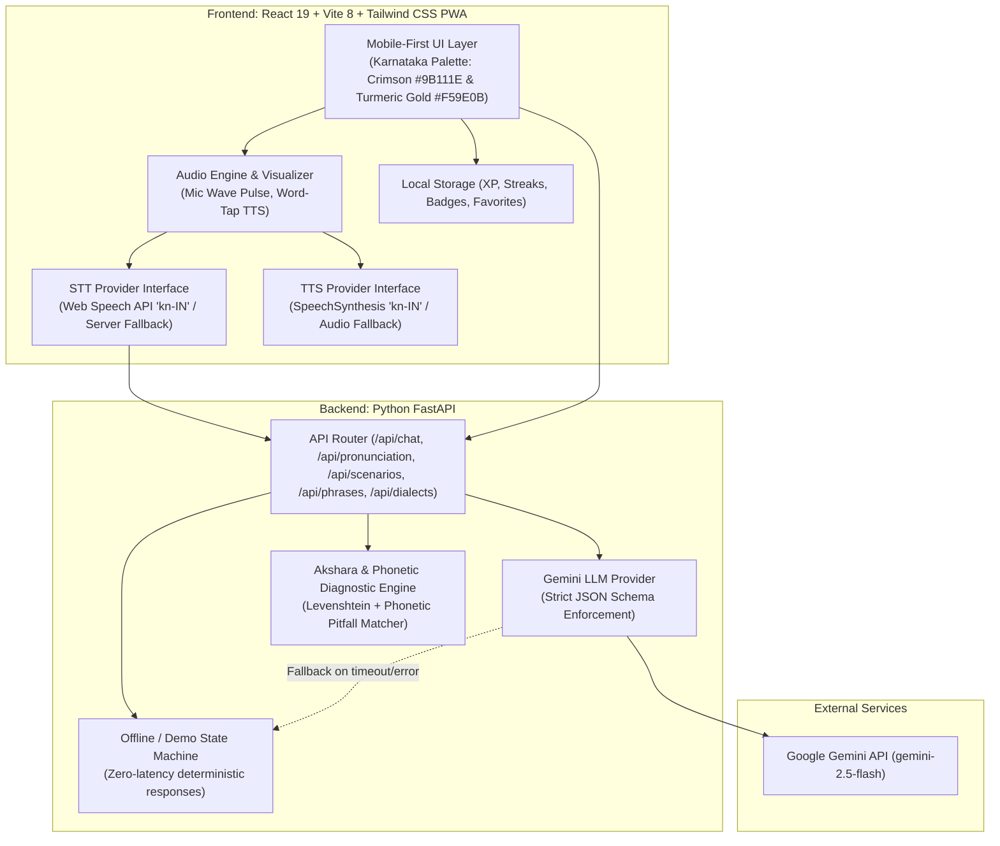

# Voice of Kannada (ಕನ್ನಡದ ಧ್ವನಿ)

> **Event**: Kannada Digital Innovation Hackathon 2026  
> **Problem Statement**: *"Develop a voice-based application that enables users to speak in Kannada and receive meaningful responses, pronunciation feedback, or language-learning assistance."*

---

## 🌟 Vision & Overview

**Voice of Kannada (ಕನ್ನಡದ ಧ್ವನಿ)** is an AI-powered, voice-first spoken Kannada coach built specifically for non-Kannada speakers (newcomers, travelers, students, and workers in Karnataka). Instead of dry grammar drills, it empowers learners to hold practical, culturally warm conversations in everyday situations — hailing an auto, ordering breakfast at a darshini, bargaining at a vegetable market, or greeting neighbors.

The application **listens**, **understands**, **responds aloud in Kannada**, provides **instant word-tap meanings**, and coaches pronunciation with **lenient accent diagnostics**.

---

## 🚀 Key Features

| Requirement | Feature | Description |
| :--- | :--- | :--- |
| **FR-1** | **Voice Practice** | Interactive AI tutor dialogue with listening radar animation, Kannada script, transliteration, English meaning, and spoken audio response. |
| **FR-1** | **Interactive Word-Tap** | Tap **any word** in any sentence to hear its isolated audio, see its Roman transliteration, and view its English translation. |
| **FR-2** | **Scenario Missions** | 6 guided 3–5 turn real-life role-plays (*Auto Ride, Dosa Camp Restaurant, Gandhi Bazaar Market, Asking Directions to Metro, Medical Store, Friendly Self-Introduction*). Includes turn counter, live partner role-play, and completion badges. |
| **FR-3** | **Pronunciation Feedback** | 0–100 accuracy gauge, word-by-word status tags (green/yellow/red), and actionable phonetic coaching tips (aspirations, retroflexes, vowel length). |
| **FR-4** | **Demo Safety (Zero-Failure)** | Top bar Demo Mode switch with zero-latency deterministic offline fallback state machine for all scenarios. Includes an instant "Type instead" drawer for noisy rooms. |
| **FR-5** | **Survival Phrasebook** | 40+ curated phrases across 7 categories with audio, instant search, and bookmarking. |
| **FR-6** | **Learner Levels** | One-tap switch between **Beginner** (heavy English assistance & transliteration) and **Intermediate** (immersion). |
| **FR-7** | **Regional Dialect Flavors** | Highlights differences across **Bengaluru** (casual/urban), **Mysuru** (gentle royal "Ree"), **Uttara Karnataka** (vibrant Hubballi-Dharwad "Aram adeerenri"), and **Karavali/Coastal** (Mangaluru/Udupi cadence). |
| **FR-8** | **Gamified Progress** | XP awards (+25 for chat, +50 for pronunciation check, +150 for completed missions), streaks, and badges saved locally. |

---

## 🏛️ System Architecture



---

## 🛠️ Tech Stack & Decisions

- **Frontend**: React 19, TypeScript, Vite 8, Tailwind CSS v4, Lucide Icons, Canvas Confetti.
  - *Decision*: Vite provides sub-second HMR and instant mobile load (<1s). Tailwind v4 delivers a native app feel on mid-range Android devices.
- **Backend**: Python 3.13, FastAPI, Uvicorn, Pydantic v2.
  - *Decision*: Async high-performance routing with strict JSON schemas and fast cold starts.
- **Speech-to-Text (STT)**: Web Speech API (`kn-IN`) by default with fallback server endpoint.
  - *Decision*: Web Speech API runs with zero server latency directly in Chrome mobile and desktop.
- **Text-to-Speech (TTS)**: Web SpeechSynthesis (`kn-IN`) behind a provider interface with fallback audio hints.
- **LLM**: Google Gemini API (`gemini-2.5-flash`) with structured schema validation and fallback to deterministic offline scenario engines.
- **Phonetics Engine**: Custom Akshara normalizer + Levenshtein distance + rule-based diagnostic coaching for tricky Kannada phonemes (e.g. `ಧ` aspiration, `ಳ` retroflex, `ಬೇಕು` vowel quantity).

---

## ⚡ Quickstart (Single Documented Command)

### Prerequisites
- Node.js (v18+) and npm
- Python (v3.10+)

### 1. Launch the App
Run either of the following commands in the project root:

**Windows**:
```bat
start.bat
```
*or in PowerShell:*
```powershell
python run.py
```

**macOS / Linux**:
```bash
python3 run.py
```

This single command launches both:
- **FastAPI Backend**: `http://localhost:8000` (API Docs: `http://localhost:8000/docs`)
- **React Frontend**: `http://localhost:5173`

Open **`http://localhost:5173`** in Google Chrome or Chrome for Android!

---

## ⚙️ Configuration (.env)

Configuration is managed via `.env`. See `.env.example`:

```env
PORT=8000
HOST=0.0.0.0
FRONTEND_PORT=5173

# Optional: Gemini API Key for live AI dialogues (Free from https://aistudio.google.com/)
# If empty or network fails, app automatically uses high-fidelity offline mode!
GEMINI_API_KEY=
GEMINI_MODEL=gemini-2.5-flash

LLM_PROVIDER=gemini
STT_PROVIDER=web_speech
TTS_PROVIDER=web_speech
FORCE_OFFLINE_DEMO=false
```

---

## 🧪 Testing

Run the automated backend test suite:
```bash
python -m pytest backend/tests/test_api.py -v
```
All 9 test suites verify health check, scenario progression, exact and lenient pronunciation feedback, phrase filtering, and dialect variants.

Verify the frontend build:
```bash
cd frontend && npm run build
```

---

## 📁 Repository Structure

```
Kannada Hackathon/
├── .env.example                       # Config template
├── .env                               # Local environment settings
├── README.md                          # Full documentation
├── DEMO_SCRIPT.md                     # 2-minute judge walkthrough
├── FUTURE_SCOPE.md                    # Roadmap & future architectural vision
├── run.py                             # Unified cross-platform runner
├── start.bat                          # One-click Windows starter
├── start.ps1                          # PowerShell starter
│
├── backend/
│   ├── config.py                      # App settings & provider switches
│   ├── main.py                        # FastAPI endpoints & CORS
│   ├── requirements.txt               # Backend dependencies
│   ├── models/schemas.py              # Pydantic data models
│   ├── services/
│   │   ├── llm_service.py             # Gemini API integration + fallback
│   │   ├── offline_mock_service.py    # Zero-network scenario dialogue engine
│   │   ├── pronunciation_service.py   # Akshara phonetics & 0-100 evaluator
│   │   └── stt_service.py             # Server STT provider interface
│   ├── data/
│   │   ├── scenarios.json             # 6 guided role-play missions
│   │   ├── phrases.json               # 40+ survival phrases
│   │   └── regional_dialects.json     # Bengaluru, Mysuru, UK, Karavali
│   └── tests/test_api.py              # Automated test suite
│
└── frontend/
    ├── package.json                   # UI packages
    ├── vite.config.ts                 # Vite setup with /api proxy
    ├── index.html                     # Noto Sans Kannada webfonts
    ├── src/
    │   ├── main.tsx                   # App bootstrap
    │   ├── App.tsx                    # Shell layout & bottom navigation
    │   ├── types/index.ts             # TypeScript interfaces
    │   ├── services/
    │   │   ├── api.ts                 # Backend client with demo fallback
    │   │   ├── speechRecognition.ts   # Web Speech API wrapper
    │   │   ├── speechSynthesis.ts     # Kannada TTS wrapper
    │   │   └── storage.ts             # XP & streaks LocalStorage store
    │   ├── components/                # Header, MicButton, WordTappable, Visualizer, etc.
    │   └── views/                     # VoiceTutorView, MissionsView, PronouncePractice, PhrasebookView
```

---

## 🏆 Hackathon Compliance Checklist

- [x] **P0 FR-1 Voice Practice**: Spoken input, Kannada script, transliteration, English meaning, spoken AI reply, interactive word tap.
- [x] **P0 FR-2 Scenario Missions**: 6 role-play missions, key phrases cheatsheet, partner persona, completion badges.
- [x] **P0 FR-3 Pronunciation Feedback**: 0-100 score, per-word status highlights, actionable phonetic tip, retry flow.
- [x] **P0 FR-4 Demo Safety**: One-click Demo Mode toggle, deterministic offline scenario engine, "Type instead" drawer fallback.
- [x] **P1 FR-5 Survival Phrasebook**: 40+ phrases across 7 categories, search, audio, favorites.
- [x] **P1 FR-6 Learner Level**: Beginner and Intermediate modes.
- [x] **P2 FR-7 Regional Flavor**: Bengaluru, Mysuru, Uttara Karnataka, and Karavali dialect comparisons.
- [x] **P2 FR-8 Progress**: XP, day streaks, badges stored in LocalStorage.
